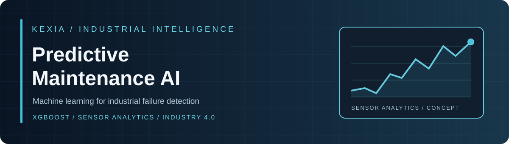
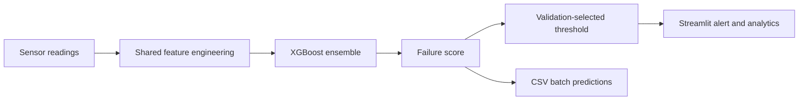
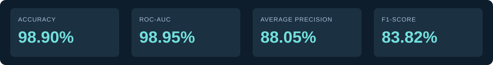
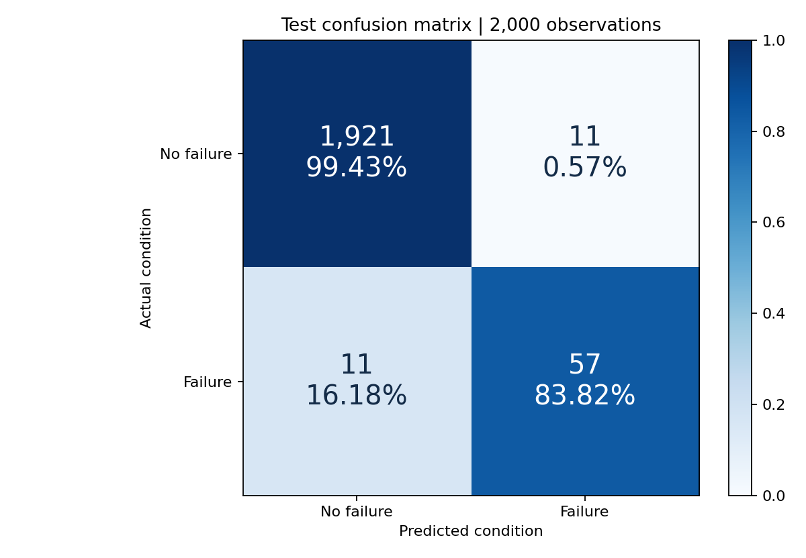
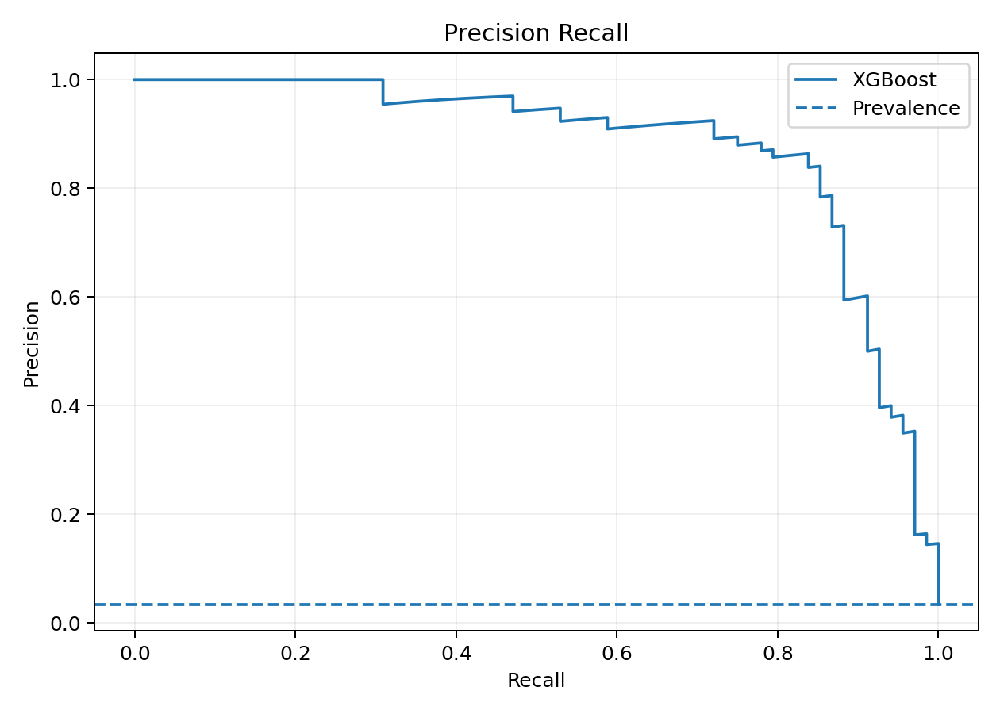
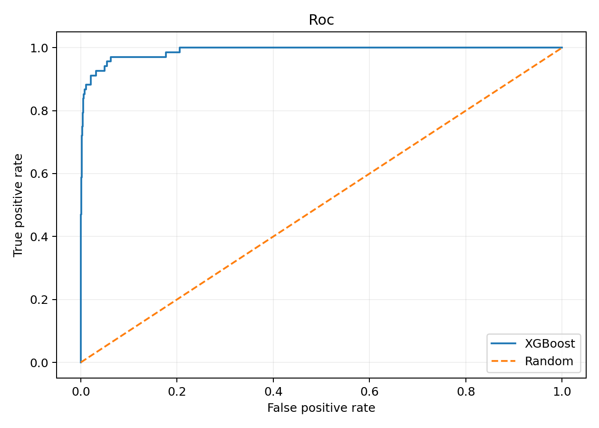
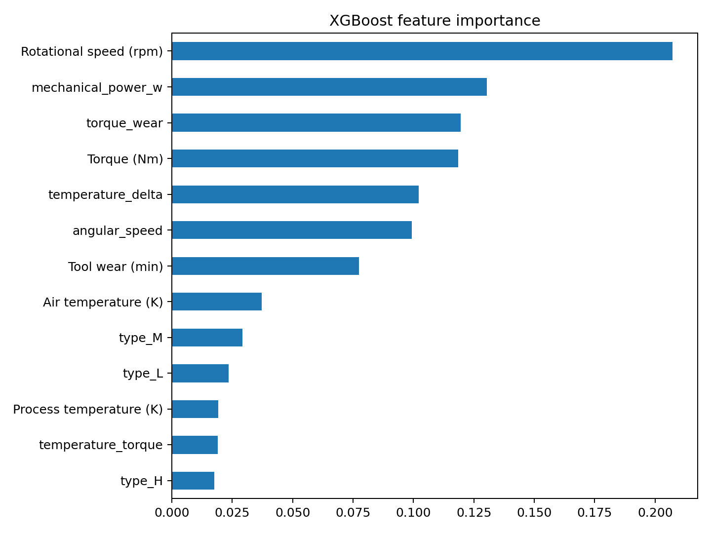

<div align="center">



# Industrial Predictive Maintenance AI

**Machine failure detection · Physics-informed features · Interactive industrial analytics**

   

[Methodology](#methodology) · [Mathematics](#mathematical-foundation) · [Results](#experimental-results) · [Quick start](#quick-start) · [Deployment](#cloud-deployment)

</div>

## Overview

Kexia's Industrial AI Monitor is a reproducible machine learning prototype for identifying operating conditions associated with machinery failure. It combines sensor-based feature engineering, gradient-boosted decision trees and an interactive Streamlit application for manual and batch inference.

The project is designed as a demonstration for manufacturing, automotive quality engineering and Industry 4.0 analytics. It runs locally on a CPU, without external AI APIs or quantum computing dependencies.

> **Scope:** AI4I is a synthetic benchmark. This is contemporaneous failure classification, not a forecast of future failure time or remaining useful life (RUL). The dashboard is not a safety controller.

## System architecture



The application loads a serialized model and its metadata; training is performed separately. The same `features.py` transformation is used in both paths to avoid training-serving skew.

## Dataset

[AI4I 2020 Predictive Maintenance Dataset — UCI](https://archive.ics.uci.edu/dataset/601/ai4i), licensed CC BY 4.0.

| Dataset characteristic | Value |
|---|---:|
| Observations | 10,000 |
| Failure cases | 339 (3.39%) |
| Non-failure cases | 9,661 |
| Training / validation / test | 6,000 / 2,000 / 2,000 |
| Input variables | 6 raw; 13 transformed |

| Input | Unit / encoding |
|---|---|
| Air and process temperature | K |
| Rotational speed | rpm |
| Torque | N·m |
| Tool wear | min |
| Product type | L, M, H (one-hot) |

The target is `Machine failure` (0 or 1). Identifiers and the five failure subtype labels are excluded from model inputs to prevent direct target leakage.

## Methodology

1. Stratified split with seed 42, preserving class prevalence.
2. Deterministic feature engineering using physical relationships.
3. Six XGBoost candidates: depths 3 and 5 crossed with three positive-class weights (1, square root of imbalance ratio, and imbalance ratio).
4. Early stopping (35 rounds) on validation AUCPR; select the candidate with highest validation average precision (AP).
5. Select the decision threshold by maximizing validation F1, then report test results.

| Selected configuration | Value |
|---|---:|
| Maximum depth | 5 |
| Learning rate | 0.04 |
| Maximum boosting rounds | 500 |
| Best iteration (zero-based) | 175 |
| Effective prediction rounds | 176 |
| Row / column sampling | 0.9 / 0.9 |
| L2 regularization | 2 |
| Positive class weight | 1.0 |
| Tree method | hist |
| Validation AP | 0.8586 |
| Operating threshold | 0.354924 |

Earlier test results were observed during project development. The current holdout therefore is not a pristine external validation set. No claim of field reliability is made.

## Mathematical foundation

### Physics-informed feature engineering

For process temperature $T_p$, air temperature $T_a$, rotational speed $n$, torque $\tau$ and wear $w$:

$$\Delta T=T_p-T_a,\qquad \omega=\frac{2\pi n}{60}$$

$$P=\tau\omega,\qquad I_w=\tau w,\qquad I_T=\Delta T\,\tau$$

$P$ is estimated mechanical power in watts. The two interaction terms are engineered predictors, not independently measured failure mechanisms. Together with five numeric raw inputs and three one-hot product indicators, these produce 13 features.

### Gradient boosted trees

XGBoost learns an additive ensemble of regression trees. For binary classification the raw margin is

$$z_i=b+\sum_{k=1}^{K}\eta f_k(\mathbf{x}_i),\qquad s_i=\sigma(z_i)=\frac{1}{1+e^{-z_i}}$$

where $b$ is the initial margin, $f_k$ is a tree and $\eta$ is the learning rate (the serialized tree contributions already incorporate shrinkage).

The regularized binary logistic objective can be written as

$$\mathcal{L}=\sum_i a_i[-y_i\log(s_i)-(1-y_i)\log(1-s_i)]+\sum_k\Omega(f_k)$$

$$\Omega(f)=\gamma T+\frac{\lambda}{2}\sum_{j=1}^{T}w_j^2$$

where $a_i$ is the sample/class weight, $T$ is the number of leaves and $w_j$ is a leaf value. For logistic loss, first- and second-order derivatives with respect to the margin are $g_i=a_i(s_i-y_i)$ and $h_i=a_i s_i(1-s_i)$. The approximate gain of a candidate split (without L1 regularization) is

$$\mathrm{Gain}=\frac12\left[\frac{G_L^2}{H_L+\lambda}+\frac{G_R^2}{H_R+\lambda}-\frac{(G_L+G_R)^2}{H_L+H_R+\lambda}\right]-\gamma$$

This lets the ensemble capture nonlinear interactions among operational variables while regularizing tree complexity.

### Inference and decision rule

The deployed model computes `predict_proba(X)[:, 1]` after applying the shared feature transformation and saved feature order. An alert is emitted when

$$\hat y_i=\mathbb{1}[s_i\geq 0.3549240231513977]$$

The threshold is stored in `models/metadata.json`. Scores are not calibrated failure probabilities; a low score does not guarantee safe operation.

## Experimental results

<div align="center">

</div>

| Metric | Held-out test |
|---|---:|
| Accuracy | 98.90% |
| Balanced accuracy | 91.63% |
| ROC-AUC | 0.9895 |
| Average precision | 0.8805 |
| Precision | 83.82% |
| Recall | 83.82% |
| F1-score | 83.82% |
| Specificity | 99.43% |
| Matthews correlation coefficient | 0.8325 |
| Brier score | 0.00895 |

The test prevalence is 3.40%; a classifier that always predicts no failure would obtain 96.60% accuracy. AP and recall are thus more informative than accuracy alone. AP summarizes precision across recall levels; ROC-AUC measures ranking discrimination. F1 is the harmonic mean of precision and recall at the chosen threshold.

### Confusion matrix

<div align="center"></div>

Of 68 actual failures, 57 were correctly detected and 11 were missed. Eleven of the 1,932 non-failure records triggered false alarms. These errors motivate further threshold and cost-sensitive evaluation before real deployment.

$$\mathrm{Precision}=\frac{57}{57+11},\quad \mathrm{Recall}=\frac{57}{57+11},\quad F_1=\frac{2PR}{P+R}$$

### Discrimination curves

| Precision–recall | ROC |
|---|---|
|  |  |

### Feature importance



Tree-based importance describes model usage of features, not causal effects. Correlated and derived features can share importance.

The recorded training and candidate-selection time was 0.523 s, and the test scoring time was 0.00235 s for 2,000 rows in the original run. These are environment-specific measurements, not guaranteed production latency. See [metrics](results/metrics.json) and [validation search](results/validation_search.csv).

## Industrial AI Monitor

The dashboard offers manual sensor assessment, a score gauge, threshold-based alerts, session history, batch CSV scoring with downloadable outputs, training-range warnings and model evaluation charts. It does not connect to physical sensors. History reflects evaluations in the current session, not live telemetry.

## Quick start

Python 3.11 is recommended for the local environment. The supplied model was trained with Python 3.13.5, XGBoost 3.1.3 and scikit-learn 1.8.0.

```powershell
py -3.11 -m venv .venv
.\.venv\Scripts\python.exe -m pip install -r requirements.txt
.\.venv\Scripts\python.exe -m streamlit run app.py
```

Open `http://localhost:8501`. **Retraining is not required** when the supplied model and metadata are available.

To reproduce training, download the AI4I CSV from UCI and place it in `data/ai4i2020.csv` (or the repository root), then run:

```powershell
.\.venv\Scripts\python.exe train_model.py
```

Retraining overwrites the saved model and results; archive them first. The raw CSV is not required for manual inference or the saved-test-record demo.

## Repository layout

```text
app.py                 # Streamlit interface
train_model.py         # Training, validation, evaluation and exports
features.py            # Shared deterministic feature engineering
requirements.txt       # Python dependencies
.streamlit/config.toml # Dashboard theme
models/
  xgboost.json         # Serialized ensemble
  metadata.json        # Feature order, threshold, versions, ranges
results/               # Metrics, predictions, split indices and plots
assets/                # README illustrations
```

## Cloud deployment

Open [Streamlit Community Cloud](https://share.streamlit.io/), connect GitHub, create an app and select:

| Setting | Value |
|---|---|
| Repository | `Kexia89/industrial-predictive-maintenance-ai` |
| Branch | `main` |
| Main file path | `app.py` |
| Python | 3.11 (if offered) |

Keep the model, metadata, result files and requirements in the repository. No API keys are needed for this implementation. The public demo URL can be added here after successful deployment. [Official deployment guide](https://docs.streamlit.io/deploy/streamlit-community-cloud/deploy-your-app/deploy).

## Limitations and next steps

- Validate on real machinery and temporally separated, site-specific data.
- Assess calibration, drift and out-of-distribution cases.
- Select alert thresholds using real costs of missed failures and false alarms.
- Investigate time-to-failure models using longitudinal sensor data and RUL labels.
- Add authenticated telemetry integration only after appropriate engineering and security reviews.

## References

- Chen, T. & Guestrin, C. (2016). *XGBoost: A Scalable Tree Boosting System*. [DOI](https://doi.org/10.1145/2939672.2939785).
- Matzka, S. (2020). *AI4I 2020 Predictive Maintenance Dataset*. [UCI dataset](https://archive.ics.uci.edu/dataset/601/ai4i).
- [XGBoost documentation](https://xgboost.readthedocs.io/).
- [Scikit-learn model evaluation](https://scikit-learn.org/stable/modules/model_evaluation.html).
- [Streamlit documentation](https://docs.streamlit.io/).

---
<div align="center"><strong>KEXIA</strong> · Applied Artificial Intelligence · Industrial Analytics</div>
